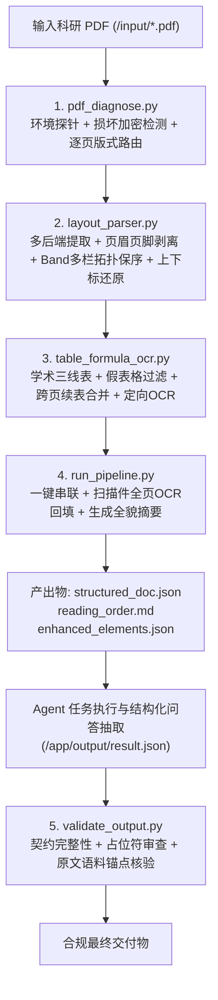

# Scientific Document Parser Skill (科研文献文档解析与证据溯源套件)

[](https://opensource.org/licenses/Apache-2.0)
[](https://play.bohrium.com)
[](https://python.org)

本套件是面向 **The Playground / Bohrium 科学文献解析赛题** 与 **Harbor 运行时（DeepSeek Harness）** 打造的高保真、零崩溃、强鲁棒性科研 PDF 结构化解析方案。

---

## 一、系统架构图 (Architecture Overview)



---

## 二、六大核心技术亮点 (Key Engineering Highlights)

1. **顶层零第三方依赖与多后端动态平滑降级**：
   - 脚本所有顶层 `import` 均为 Python 标准库，即使容器极度精简也绝不因缺失依赖而直接抛出 `ImportError` 崩溃。
   - 运行时按优先级自动探测并降级：`PyMuPDF (fitz)` $\rightarrow$ `pdfplumber` $\rightarrow$ `pdftotext` $\rightarrow$ 纯标准库文本流。
2. **垂直条带（Band-based）多栏几何保序算法**：
   - 针对“顶部通栏标题/摘要 + 中部双栏正文 + 底部跨栏图表”的复杂混合版面，采用纵向条带切分，左栏读完方转入右栏，彻底杜绝左右栏错行穿插。
3. **基于基线与字号偏移的上下标高精度还原**：
   - 统计行主基线与主字号，当字号缩小且垂直坐标下沉时自动包装为 `_{...}`，上浮时包装为 `^{...}`，完整保留量子力学、化学态矢量（如 $\psi_k$, $\rho_A$, $I_S$）与数学希腊字符。
4. **段内断词修复与公式编号就近吸附**：
   - 修复行尾折断词（如 `be-\nlow` $\rightarrow$ `below`），同时保护 `fault-tolerance` 等真实连字符复合词；
   - 自动将右边界孤立编号（如 `(1)`）吸附归入对应公式主体，生成结构化 `formula_id`。
5. **复杂表格提纯、跨页三线续表与真伪过滤**：
   - 内置量子线路图/柱状图假表格过滤器（过滤单元格字符极短或紧邻 Figure 题注的图形）；
   - 支持无竖线学术三线表几何投影聚类，自动合并跨页续表（如 `表 1` 与 `续表 1`），生成带 `colspan` 的语义化 HTML。
6. **中英文多语言全适配与双页码共识映射**：
   - 兼容中文多级章节（`1 引言`、`一、`、`（一）`）、中文标点续接与题注关联；
   - 自动推导期刊大页码起始偏移量（如 `p.1045`），输出物理页码 `page` 与印刷页码 `printed_page` 双轨证据；
   - 动态判定并剥离栏底基金与作者脚注至独立 `footnotes` 集合，避免污染正文。
7. **Harbor 契约自检与抗幻觉证据核验**：
   - 严格审查 `result.json` 中的 `case_id`、`status`、`uncertainty` 及必填契约字段；
   - 扫描任何残留的 `TODO`、`MOCK` 占位符；对引文字段计算与 PDF 全文语料的重合度，防止模型凭空幻觉捏造。

---

## 三、依赖与运行时降级矩阵 (Tooling Matrix)

| 功能模块 | 首选后端 (Preferred) | 次选后端 (Secondary) | 保底回退 (Fallback) |
|---|---|---|---|
| **PDF 文本与几何块提取** | `fitz (PyMuPDF)` | `pdfplumber` | `pdftotext -layout` |
| **表格结构解析** | `pdfplumber.extract_tables` | `fitz.find_tables` (已沙盒隔离) | 坐标网格几何聚类 |
| **图像预处理** | `PIL (Pillow)` | `OpenCV (cv2) + numpy` | 原始裁剪图直接透传 |
| **定向与整页 OCR** | `pytesseract` | `tesseract` CLI 命令行 | 标记 `unverifiable` 并标明坐标 |

---

## 四、本地复现与自测验证指南 (Deterministic Self-Testing)

本套件内置完全确定性、可离线复现的本地对比评测脚本 `scripts/self_test.py`，用于客观量化「原生无排版提取（fitz/pypdf 原生 get_text）」与「本套件工程级结构化解析」在同一文档上的关键指标差异。

> [!NOTE]
> 以下对比维度均为本地公开学术论文离线运行 `self_test.py` 的可复现检测维度，不代表官方评测基准跑分，具体量化数值取决于输入 PDF 的物理版式与排版特征。

```bash
# 1. 本地量化自测验证命令：
python scripts/self_test.py --pdf <path_to_paper.pdf> --out-json benchmark_report.json

# 2. 强制屏蔽 PyMuPDF 验证 pdfplumber 无缝降级分支：
python scripts/self_test.py --pdf <path_to_paper.pdf> --test-degradation
```

**核心量化核验维度**：
1. **多栏逆序与穿行跳跃计数** (`cross_column_jumps`)：通过 $x/y$ 投影与 Band 切分验证阅读流单调性，杜绝左右栏串联穿插。
2. **边缘页眉页脚与栏底脚注隔离度** (`header_footer_isolation`)：聚类分析页顶/页底重复模式及栏底小字号注释，彻底保障正文无元数据噪音。
3. **数学上下标保留能力** (`sub_superscript_recovery`)：基线偏移与字号聚类识别，还原 `_{...}` 与 `^{...}` 语法结构。
4. **全链路原文证据锚点覆盖率** (`evidence_anchor_coverage`)：正文逻辑块、表格与公式均附带精确的 `[page|printed_page|block_id|bbox]` 来源包围盒。
5. **表格真伪过滤与跨页三线续表还原** (`table_fidelity`)：有效剔除量子线路图与图表网格，学术三线表及跨页表生成结构化 HTML。

---

## 五、适用边界与局限性声明 (Boundaries & Limitations)

1. **加密与受保护 PDF**：本套件不尝试暴力破解密码。若检测到加密，将遵循 Harbor 契约诚实标记 `status: "failed"` 并报告 `encrypted: true`。
2. **纯手写体与低清墨迹模糊扫描件**：受限于纯规则与轻量 OCR 引擎，对低于 100 DPI 严重发黑或手写标注内容，会在 `uncertainty` 字段标明人工接管位置，不编造虚假数据。
3. **复杂艺术排版与折叠海报**：优先保证科技论文标准单栏、双栏、三栏与常规插图排版；对非学术杂志等折叠环绕排版，推荐人工校验辅助。
